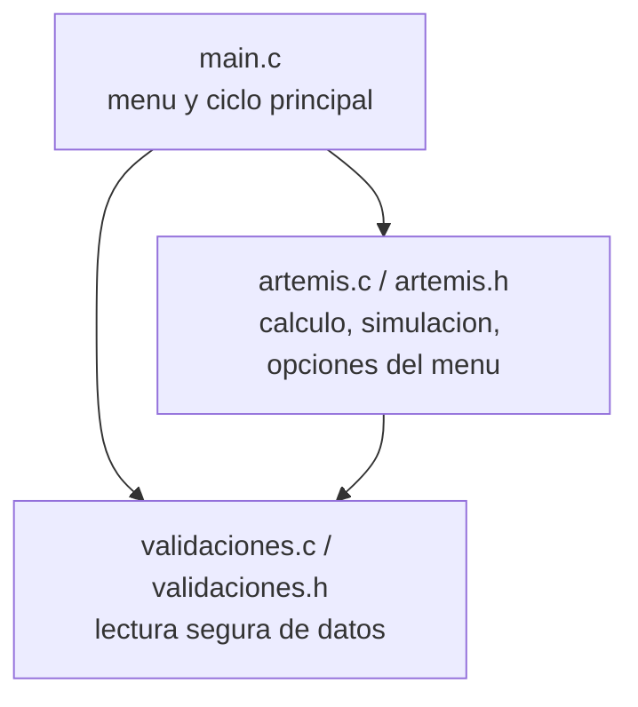

# ARTEMIS - Simulador de ascenso del cohete SLS

Trabajo Final Integrador C - Algoritmos y Estructuras de Datos - UTN FRRe
Situacion 1: ascenso del cohete SLS con desacople de los propulsores (SRB).

Programa de consola en C99 que calcula (de forma analitica) y simula (paso a paso) el ascenso
de un cohete en dos fases y compara ambos resultados.

## Modelo fisico

1. **Fase 1 (SRB + nucleo):** aceleracion constante `a1` durante `t1` segundos. Al final: `v1 = a1*t1`, `y1 = a1*t1^2/2`.
2. **Fase 2 (solo nucleo):** aceleracion constante `a2` hasta la altitud final `h`: `v2 = sqrt(v1^2 + 2*a2*(h - y1))` y `t2 = t1 + (v2 - v1)/a2`.
3. **Fase inercial:** con los motores apagados el cohete sube hasta el apogeo: `Hmax = h + v2^2/(2*g)`, con `g = 9,80 m/s^2`.
4. **Gmax:** aceleracion de la primera fase expresada en g (`a1/g`). Si supera 3 g se muestra una advertencia.

## Arquitectura



| Archivo | Responsabilidad |
| --- | --- |
| `artemis.h` | Constantes, `enum Fase`, `struct` (`Mision`, `Estado`, `Resultados`, `Telemetria`, `Sesion`) y prototipos |
| `artemis.c` | `calcular_analitico`, `mision_valida`, `avanzar_turno`, `avanzar_balistico`, `simular_ascenso`, `configurar_mision`, `mostrar_analisis` |
| `validaciones.h` / `validaciones.c` | `leer_double` y `leer_entero`: leen una linea con `fgets`, la convierten con `strtod`/`strtol` y rechazan entradas invalidas |
| `main.c` | Menu (opciones 1, 2, 3 y 0) |
| `Makefile` | Compilacion modular con `make` |

## Compilar y ejecutar

```
make
./artemis
```

Sin `make`: `gcc -std=c99 -Wall -Wextra -pedantic main.c artemis.c validaciones.c -o artemis -lm`
(el `-lm` es necesario por `sqrt`). En Windows se puede usar MinGW o WSL.

Para borrar los archivos compilados: `make clean`.

## Uso

Menu: **1** configurar mision, **2** simular ascenso, **3** ver analisis (con comparacion contra la simulacion), **0** salir.
Datos por defecto (los del enunciado): `a1 = 20`, `t1 = 120`, `a2 = 12,5`, altitud final `160 km`, `dt = 10`.

Resultados esperados con esos datos:

| Magnitud | Valor |
| --- | --- |
| v1 / y1 | 2400,00 m/s / 144,000 km |
| v2 / t2 | 2481,93 m/s / 126,55 s |
| Hmax | 474,286 km |
| Gmax | 2,04 g |

## Validaciones

- El menu y los datos se leen como texto: se rechazan letras, `12abc`, `nan`, `inf`, valores vacios y valores fuera de rango, y se vuelve a pedir el dato explicando el error. El separador decimal es el **punto**.
- Si los SRB solos ya superan la altitud final (por ejemplo `a1 = 60`, `t1 = 300`, `h = 1000`), la mision se rechaza y se mantiene la anterior.
- Si la entrada se cierra (Ctrl+D), el programa avisa y termina; no queda en un bucle infinito.
- La telemetria tiene un maximo de 2000 registros y se controla el limite.

## Equipo

| Integrante | Rol |
| --- | --- |
| [Nombre 1] | Coordinacion y analisis de resultados |
| [Nombre 2] | Arquitectura general y repositorio |
| [Nombre 3] | Logica de la simulacion |
| [Nombre 4] | Validaciones y menu |
| [Nombre 5] | Casos de prueba |
| [Nombre 6] | README y registro de uso de IA |

## Registro de uso de inteligencia artificial

Completar con lo que realmente hizo cada integrante. Base de lo usado hasta ahora:

| Herramienta | Para que se uso | Que hizo el equipo con el resultado |
| --- | --- | --- |
| Gemini | Generar la primera version del programa en un solo archivo | [Completar: que se reviso, probo y cambio] |
| Claude | Revisar el codigo, corregir errores (entrada de datos, mision incoherente, calculo del apogeo, fase inercial sin simular) y dividirlo en modulos | [Completar: que se entendio, probo y valido] |
| Claude | Armar el guion del video, una interfaz web de demostracion y la animacion de inicio del video | [Completar] |

Cada integrante debe poder explicar y defender cualquier parte del codigo en el coloquio.

## Correcciones respecto de la version original

Las marcas `[CORREGIDO n]` y `[MEJORA n]` en los comentarios del codigo indican cada cambio. Resumen:

- Lectura de datos con `fgets` (antes `scanf`: bucle infinito con EOF y aceptaba `12abc`).
- `nan` e `inf` rechazados con `isfinite`.
- Validacion de misiones incoherentes (antes el tiempo retrocedia en la simulacion).
- Corte de motores exacto al llegar a la altitud objetivo (cuadratica).
- Fase inercial hasta el apogeo (antes nunca se simulaba) y calculo de `Hmax` corregido.
- Telemetria guardada de verdad, con limite controlado; avisos de eventos (separacion de SRB, corte de motores, apogeo).
- Gmax calculado con la aceleracion de la primera fase.
